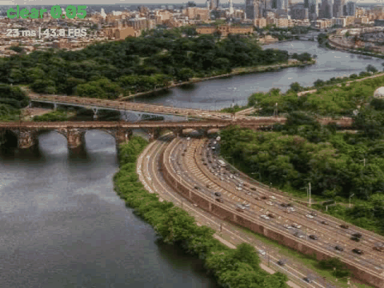
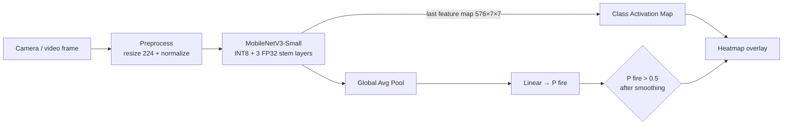
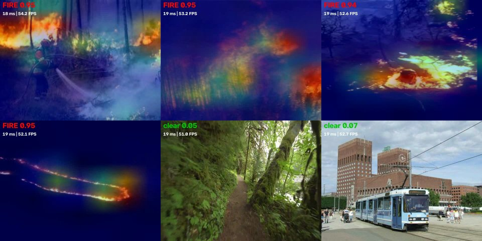

# Real-Time Fire Detection on Raspberry Pi 4

A lightweight fire / no-fire image classifier with a built-in "where is the fire"
heatmap, deployed on a **Raspberry Pi 4 (CPU only)** with **INT8 mixed-precision**
ONNX Runtime inference.

<p align="center">
  
</p>

| | |
|---|---|
| **Held-out test accuracy** | **98.9%** (leakage-free split, 2,237 images) |
| **Model size** | **1.27 MB** INT8 (3.73 MB FP32) |
| **Latency on Pi 4** | **22 ms** on 1 core · **13.5 ms** on 4 cores (model only) |
| **End-to-end on Pi 4** | **48 FPS** (decode → preprocess → model → heatmap), 640×480 video |

---

## How it works



- **Backbone:** ImageNet-pretrained MobileNetV3-Small, fine-tuned for one output (P(fire)).
- **Heatmap for free:** the classifier is *Global Average Pool → one Linear layer*, so a
  [Class Activation Map](https://arxiv.org/abs/1512.04150) is just a weighted sum of the
  last feature maps using that layer's weights — no extra network, no backward pass
  (~0.05 ms on the Pi).
- **Temporal smoothing:** an exponential moving average over frames suppresses
  single-frame false alarms.

<p align="center">
  
</p>

---

## Results

### Accuracy (held-out test set, 1,086 fire / 1,151 non-fire)

| Model | Size | Accuracy | Precision | Recall (fire) |
|---|---|---|---|---|
| FP32 | 3.73 MB | 98.84% | 99.44% | 98.16% |
| INT8, all layers | 1.28 MB | 68.31% | 99.74% | **34.81%** |
| **INT8 mixed (3 stem layers FP32)** | **1.27 MB** | **98.79%** | 99.26% | **98.25%** |

### Raspberry Pi 4 latency (ONNX Runtime 1.32, 224×224, batch 1)

| Threads | FP32 | INT8 mixed | Speed-up |
|---|---|---|---|
| 1 | 36.5 ms (27 FPS) | **22.1 ms (45 FPS)** | 1.65× |
| 4 | 18.2 ms (55 FPS) | **13.5 ms (74 FPS)** | 1.35× |

Model-only; 20 warm-up runs discarded, mean of 200 runs. p95 stays within ~1.5 ms of the mean.

### Full pipeline on the Pi 4 (INT8, 4 threads)

| Stage | Before | After |
|---|---|---|
| Preprocess | 10.0 ms | **3.6 ms** |
| Model | 13.5 ms | 13.5 ms |
| Heatmap (CAM) | 0.05 ms | 0.05 ms |
| Overlay drawing (fire frames) | 6.8 ms | **2.9 ms** |
| Per-frame pipeline (preprocess + model + CAM) | 22.2 ms | **18.7 ms** |
| End-to-end FPS, also writing annotated video | 28 FPS | **33 FPS** |
| End-to-end FPS, headless (no drawing) | — | **48 FPS** |

---

## Engineering notes

### 1. The original 99.5% accuracy was inflated — data leakage
An audit of the original dataset (`audit_dataset.py`) found:
- 21,733 files but only **14,917 unique images** — the class balance had been reached by duplicating images;
- **2,122 images present in both train and test**, and **~54% of test images** with a
  near-duplicate (e.g. the adjacent video frame) in train;
- the best checkpoint was being selected on the test set.

`make_clean_split.py` rebuilds the split: MD5 de-duplication → near-duplicate grouping with
a 64-bit difference hash (Hamming ≤ 4, union-find) → **group-aware**, class-stratified
70/15/15 train/val/test, so near-copies never straddle splits. The model is selected on
val and evaluated on test exactly once. Honest test accuracy: **98.9%**.

Training also uses **label smoothing (0.1)**, which keeps logits around ±3 instead of
±25 and gives calibrated probabilities.

### 2. Fixing INT8 accuracy
Plain post-training static quantization cut fire **recall to 35%**. Standard fixes
(entropy / percentile calibration, keeping the head or last layers in FP32, symmetric
activations) did not help, and neither did label smoothing.

`diagnose_quant.py` quantizes **one layer at a time** and ranks layers by how far the
output moves from FP32. Result: **3 of 106 layers cause 92% of the error** — all in the
network stem (first conv → hard-swish → next depthwise conv), where the hard-swish
activation has outliers that 8-bit integers cannot cover. Keeping just those three in
FP32 (`quantize.py --keep_stem_fp32`) restores accuracy to within 0.05 points of FP32
at the same size. No quantization-aware training was needed.

### 3. Pipeline optimization — profile on the target device
After quantization, about 40% of each frame was spent *outside* the model. Preprocessing
looked negligible on a laptop (2.3 ms) but cost **7.6–10 ms on the Pi**.
`benchmark.py --pipeline` and `profile_preprocess.py` broke it down:
- Normalization `(x/255 − mean)/std` (three array passes) → one fused `x·scale + bias`
  with precomputed constants: identical output, ~3 ms faster.
- `INTER_AREA` resize (4.7 ms) → bilinear to 2× size + exact 2:1 area average
  (`linear2area`): ~3.4 ms faster, accuracy change within noise (2–3 of 2,237 images),
  still anti-aliased.
- Heatmap overlay: colorize the 7×7 map before upscaling instead of float math on every
  pixel: 6.8 → 2.9 ms.

---

## Quick start

### Run on a Raspberry Pi 4
Requires **64-bit** Raspberry Pi OS (ONNX Runtime ships aarch64 wheels only).

```bash
git clone <this repo> && cd <repo>
python3 -m venv env && source env/bin/activate
pip install -r req_pi.txt

# Over SSH / no monitor: write the annotated video instead of opening a window
python infer_pi.py --model fireclf_int8.onnx --source video.mp4 --no_display --save out.mp4

# With a monitor
python infer_pi.py --model fireclf_int8.onnx --source 0        # USB webcam
python infer_pi.py --model fireclf_int8.onnx --source picam    # Pi Camera Module (picamera2)
python infer_pi.py --model fireclf_int8.onnx --source http://<phone-ip>:8080/video  # phone as IP camera

# Benchmark
python benchmark.py --models fireclf.onnx fireclf_int8.onnx --no_accuracy --threads 4
```

### Reproduce from scratch (desktop)

```bash
pip install -r req.txt

python audit_dataset.py dataset                                 # find duplicates / leakage
python make_clean_split.py --src dataset --dst dataset_clean    # leakage-free split
python audit_dataset.py dataset_clean                           # verify: all OK

python train.py --dataset_root dataset_clean --epochs 30 --out checkpoints_clean
python export.py --ckpt checkpoints_clean/best.pt --out fireclf.onnx
python quantize.py --model fireclf.onnx --calib_dir dataset_clean/train \
    --out fireclf_int8.onnx --keep_stem_fp32
python benchmark.py --models fireclf.onnx fireclf_int8.onnx --test_dir dataset_clean/test

# If INT8 loses accuracy on your model:
python diagnose_quant.py --fp32 fireclf.onnx --int8 fireclf_int8.onnx \
    --per_node Conv Mul HardSigmoid

# Demo video from test images (no camera needed)
python make_test_clip.py --test_dir dataset_clean/test --out test_clip.mp4
```

**Dataset** (not included): images in `dataset/<split>/<class>/`, with classes
`fire` and `non fire`.

---

## Repository layout

| File | Purpose |
|---|---|
| `model.py` | MobileNetV3-Small → GAP → Linear (CAM-compatible) |
| `dataset.py`, `train.py` | Data loading / augmentation, training with val-based selection |
| `audit_dataset.py` | Duplicate, leakage and label-conflict checks for any `split/class/` dataset |
| `make_clean_split.py` | De-duplication + group-aware train/val/test split |
| `export.py` | PyTorch → ONNX (outputs `logit` + `features`) and CAM weights |
| `quantize.py` | Static INT8 quantization with mixed-precision options |
| `diagnose_quant.py` | Per-op-type and per-layer quantization sensitivity analysis |
| `preprocess.py` | Shared, optimized preprocessing (must match training transforms) |
| `infer_pi.py` | Real-time inference: threaded capture, smoothing, heatmap, headless save |
| `benchmark.py` | Latency, accuracy / precision / recall, per-stage pipeline timing |
| `profile_preprocess.py` | Preprocessing sub-step profiling and variant comparison |
| `make_test_clip.py`, `make_demo_gif.py` | Demo video / README media |
| `fireclf.onnx`, `fireclf_int8.onnx`, `fireclf_cam_weights.npy` | Trained models |
| `checkpoints_clean/best.pt` | Trained PyTorch weights |
| `infer.py` | Legacy NVIDIA Jetson / TensorRT inference path |

---

## Limitations

- Frame-level **classifier**, not an object detector: it says *whether* fire is present;
  the heatmap gives a coarse location only.
- Pi numbers were measured on a **640×480 video file**, not a live camera stream.
- The non-fire class is dominated by frames from a few nature videos; real deployments
  should add hard negatives (sunsets, red lights, fireworks, headlights).
- The Pi 4 reached ~76 °C during sustained benchmarking; use a heatsink or fan for
  long-running use.

## Tech stack
PyTorch · torchvision · ONNX · ONNX Runtime (static INT8, QDQ) · OpenCV · NumPy ·
Raspberry Pi OS 64-bit

## Author
Ayush Paudel
